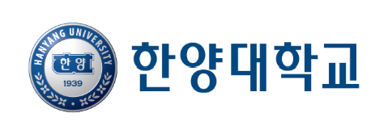
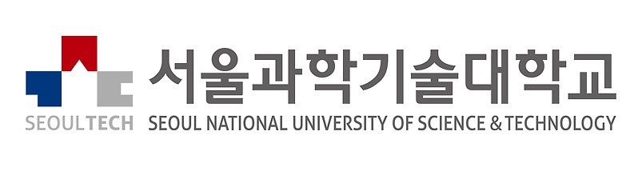
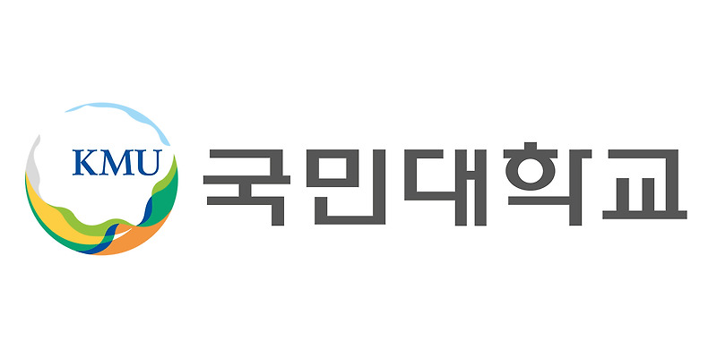

Hi! I'm Jaewon Lee, an Incoming Integrated M.S./Ph.D. student in AI at Hanyang University.

  

I am a researcher working on <strong>multimodal learning</strong> and data-centric AI. I am interested in leveraging <strong>Vision-Language Models (VLMs)</strong> to tackle a wide range of multimodal problems involving images and videos.

  

I am also keen on building high-quality <strong>synthetic datasets</strong> that faithfully reflect real-world data distributions and on exploring efficient ways to utilize them.

  


---

### News

  
Oct 2026<strong>FAIR-PIVOT</strong> accepted at <strong>CIKM 2026 Short</strong>

  
Oct 2025<strong>From Data to Model in Bias</strong> accepted at <strong>WSDM 2026</strong>

  
July 2025Joining <strong>SeoulTech</strong> as a Undergraduate Research Intern at the <strong>BIGBASE Lab</strong>

---

### Background

  

    
June 2026 – Feb 2027

    

    
<strong>Research Intern</strong>, Hanyang University · Multimodal AI Lab

  

  

    
June 2025 – Feb 2026

    

    
<strong>Research Intern</strong>, SeoulTech · BIGBASE Lab

  

  

    
Mar 2020 – Aug 2026

    

    
<strong>B.S. in AI, BigData &amp; Management</strong>, Kookmin University (GPA : 4.25/4.5)

  

---

### Awards

  

    
Dec 2024

    

    
<strong>Youth Data Analysis & Utilization Contest</strong>, Encouragement Award · KYWA

  

  

    
Nov 2024

    

    
<strong>2nd AI Big Data Analysis Competition</strong>, Grand Prize · Kookmin University

  

---

### Patents

  
Oct 2026<strong>Apparatus and method for verifying data bias</strong>, 10-2026-0147777

---
